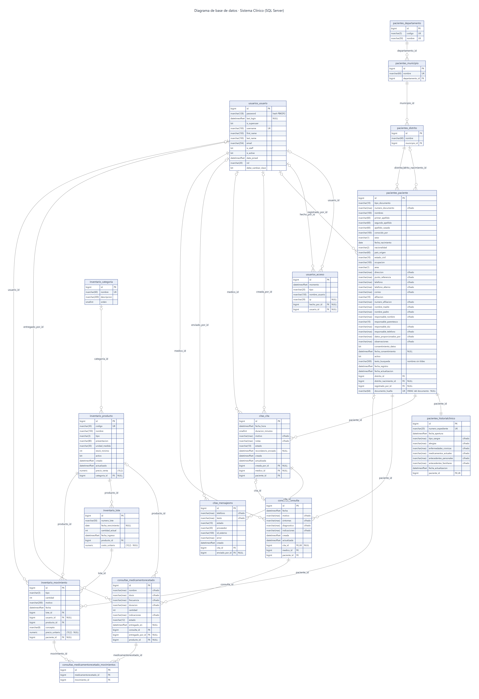
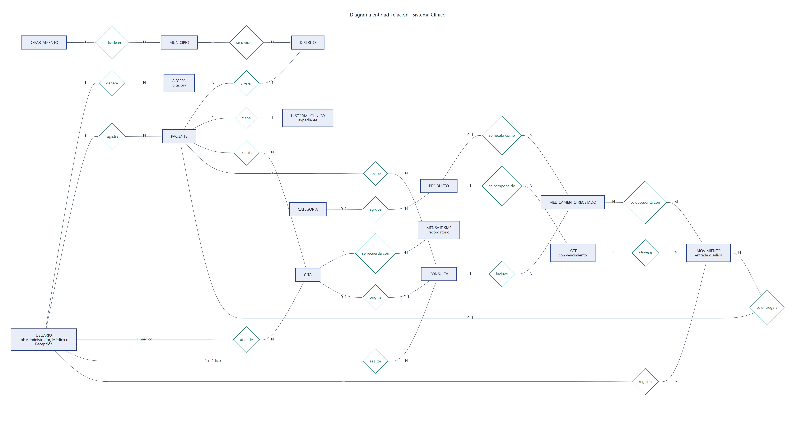
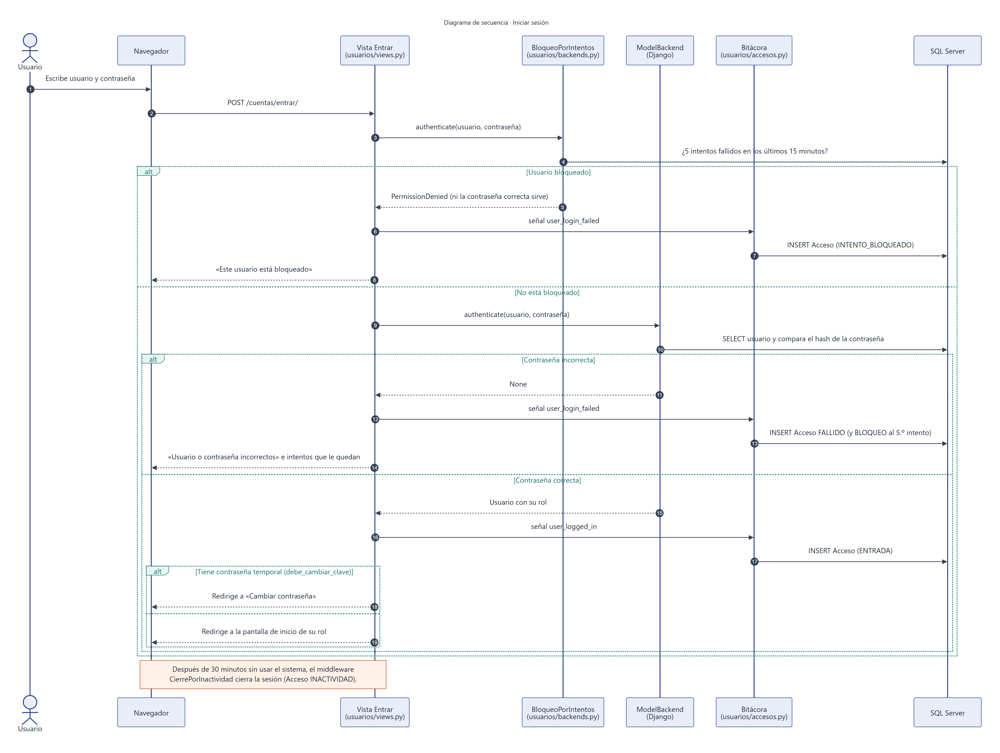
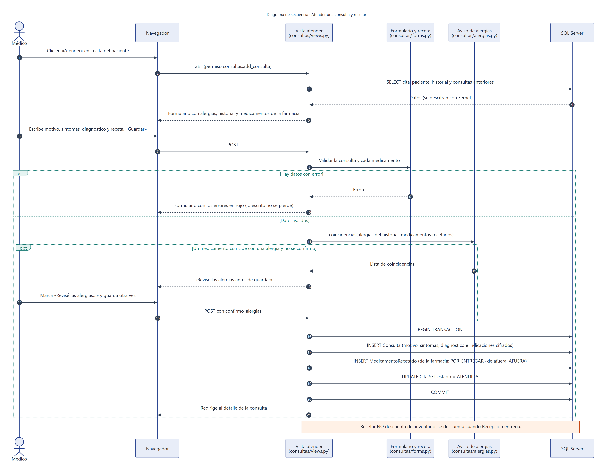
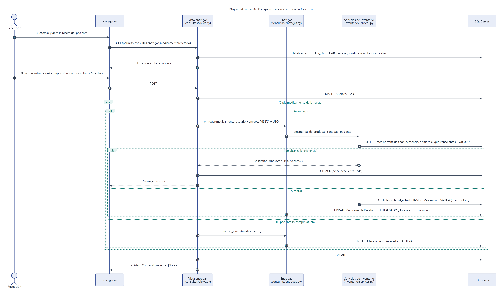
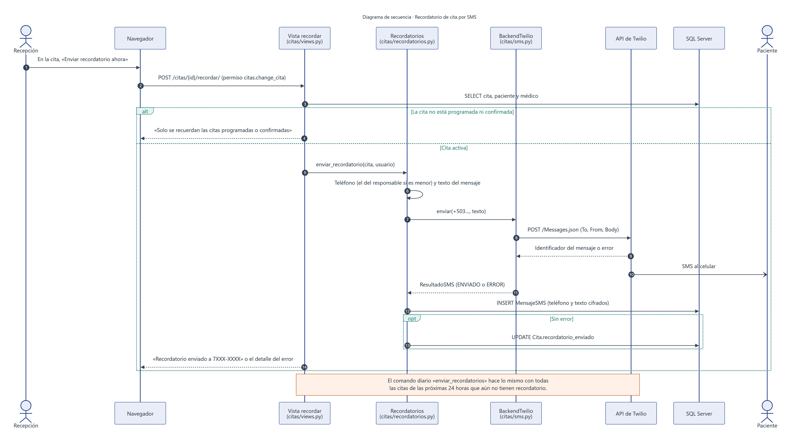

# Diagramas del Sistema Clínico

Para el documento técnico. Cada diagrama está como imagen (`.png`, para Word o Google Docs), como
`.svg` (se puede agrandar sin perder calidad en Word) y como texto Mermaid (`.mmd`), que se puede
editar en [mermaid.live](https://mermaid.live).

El diagrama de base de datos se generó **directamente de las tablas de SQL Server**, así que
coincide con el sistema real.

## 1. Diagrama de base de datos

Son las 16 tablas del sistema, con sus columnas, tipos de SQL Server y relaciones:

- **PK** es la llave primaria, **FK** una llave foránea y **UK** un valor único.
- **cifrado:** la columna se guarda cifrada con Fernet (AES). Son los datos personales y de salud:
  documento, dirección, teléfonos, historial clínico, diagnóstico, receta y SMS.
- **NULL:** la columna puede quedar vacía.
- **Líneas:**
  - `||` = exactamente uno.
  - `|o` = cero o uno.
  - `o{` = cero o muchos.

No se muestran las tablas internas de Django: sesiones, permisos, grupos, migraciones y el
registro del panel de administración.

## 2. Diagrama entidad-relación

Es el modelo conceptual: las entidades van en rectángulos, las relaciones en rombos y la
cardinalidad en cada línea (1, N, M o 0..1). Las relaciones principales:

- Un **paciente** tiene **un** historial clínico (su expediente) y vive en **un** distrito. La
  división territorial vigente es departamento → municipio → distrito.
- Un **paciente** solicita **muchas** citas. Cada **cita** es atendida por **un** médico (un
  usuario con rol Médico) y puede originar **una** consulta.
- Una **consulta** incluye **muchos** medicamentos recetados. Cada uno puede ser un **producto**
  de la farmacia o un medicamento que el paciente compra afuera.
- Un **producto** se compone de **muchos** lotes (con fecha de vencimiento). Cada entrada o
  salida queda como **movimiento** de un lote.
- Al entregar lo recetado, cada **medicamento recetado** se descuenta con **uno o varios
  movimientos**, uno por lote (relación muchos a muchos).
- Cada **usuario** genera registros en la bitácora de **accesos**.

## 3. Diagramas de secuencia

### 3.1 Iniciar sesión

- Antes de revisar la contraseña se comprueba el **bloqueo por intentos fallidos**: 5 intentos
  en 15 minutos.
- Cada entrada, intento fallido o bloqueo queda en la **bitácora de accesos**.
- Si el usuario tiene una contraseña temporal, el sistema lo obliga a cambiarla.

### 3.2 Atender una consulta y recetar

- Antes de guardar, el médico ve el **aviso de alergias** si un medicamento coincide con las
  alergias del historial.
- La consulta, la receta y el cambio de la cita a «Atendida» se guardan en **una sola
  transacción**.
- Recetar no descuenta del inventario.

### 3.3 Entregar lo recetado y descontar del inventario

- Recepción entrega la receta. El inventario se descuenta **primero del lote que vence antes**
  (FEFO) y **nunca de un lote vencido**.
- Si algo no alcanza, se deshace toda la entrega (ROLLBACK).

### 3.4 Recordatorio de cita por SMS

- El recordatorio se envía con la **API de Twilio**.
- Cada mensaje queda guardado en la cita, con el teléfono y el texto cifrados.
- El comando diario `enviar_recordatorios` hace lo mismo con todas las citas de las próximas
  24 horas.
